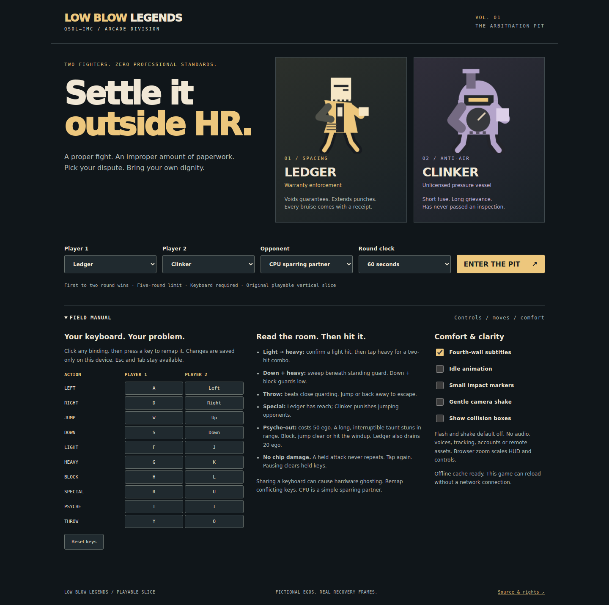
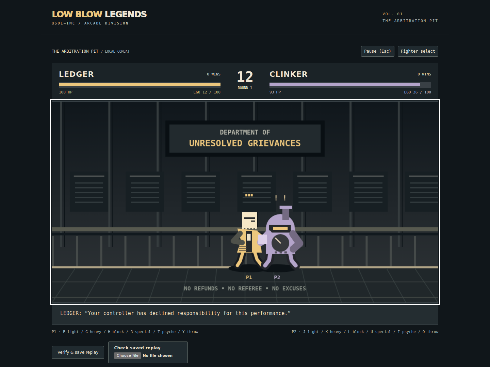
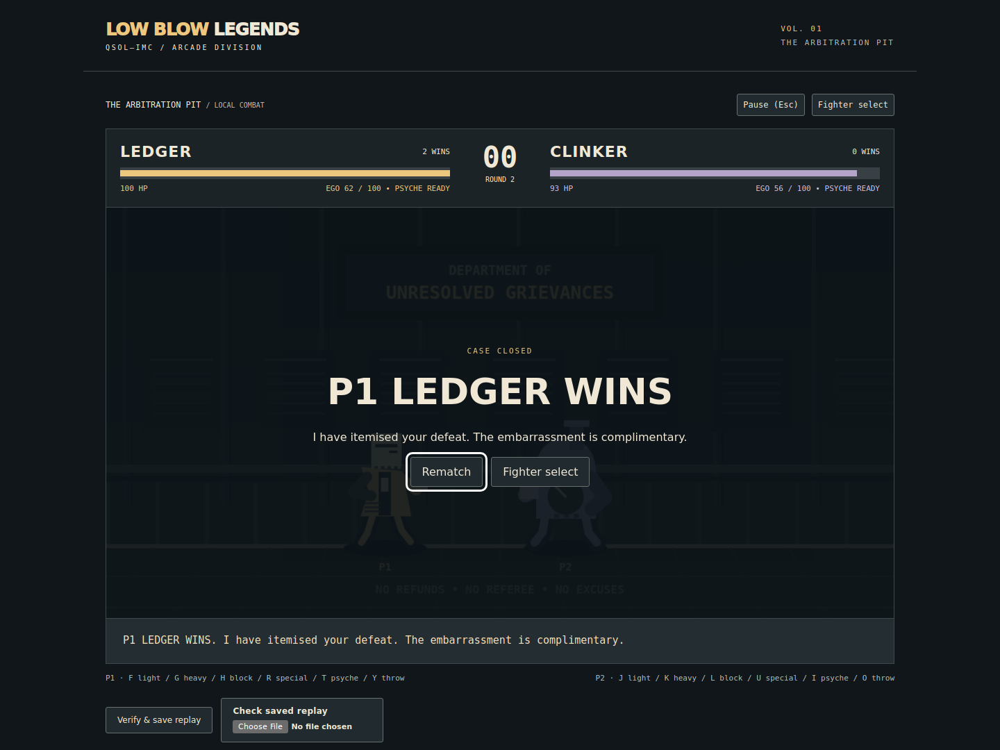

# LBL-001 implementation evidence

Scope: original playable arcade vertical slice on `feat/lbl-001-arcade-slice`, based on merged main `07758a0254543bc3272ab7ded0a7ed5a68c7684d`. The PR description records the final SHA and current CI/review outcomes; this document cannot embed its own commit hash. No main push, merge, Pages deployment or release/tag was performed.

## Implemented and exercised

Two selectable original fighters, one stage, local two-player and simple CPU, movement/jump/crouch, guard/low guard, light/heavy/air/low attacks, throws, unique specials, real light-to-heavy combo, and two costed/punishable psyche-outs. Rounds end by KO or health-based timeout, draws award no win, first to two wins or a five-round cap ends the match. Result/restart flow is implemented. Detailed parameters: [move data](MOVE_DATA.md).

The browser UI owns key remapping, pause/focus handling, help, subtitles, comfort settings, character/mode selection and bounded local replay files. Production simulation, rendering and input adapters are separate. The original reference source/tests and all sixteen invariant clauses remain preserved.

## Checks actually run locally

| Command / check | Observed outcome |
| --- | --- |
| `npm ci --ignore-scripts` | Passed; exact test-only packages installed from lockfile |
| `npm run verify` (Node 24.22.1) | Passed: structure/invariants, original asset hashes, replay SHA-256, **28 tests**, static staging |
| `git diff --check` and module syntax check | Passed |
| `npm run browser` | **Partial pass; exits nonzero** on WebKit host dependencies. Chromium full flow and Firefox parity/start/pause pass. No failure is skipped or converted to success. |
| `npx playwright install-deps webkit` | Blocked: container rejects apt `setgroups`/`seteuid`; installation exits 100 |
| Actual browser engines | Chromium 134.0.6998.35; Firefox 135.0 (Playwright 1.51.1) |
| Visual inspection | Selection, active combat, victory and narrow layout captures; crouch-pose/collision alignment corrected during development |

The complete local browser report, including the WebKit failure, is retained in [evidence/browser-report.json](evidence/browser-report.json). It records its actual runtime timestamp, ephemeral local test URL, performance samples and successful assertions. Firefox required `MOZ_DISABLE_CONTENT_SANDBOX=1` inside this isolated test container; this applies only to the test launch. CI retains **all three engines** on a pinned Ubuntu 24.04 host and does not ignore failure. Both jobs check out the actual PR head SHA. The first published head `8014c72d719cfb2a991e9125e5042f74b62d3735` passed both CI jobs, including WebKit 18.4 replay/start/pause ([run 40442689448](https://github.com/QSOLKCB/LOWBLOWLEGENDS/actions/runs/40442689448)). This verifies the supported host capability; final-head CI/review are tracked separately in the PR and must be repeated after these final audit corrections.

Chromium assertions use actual DOM events and keyboard controls, not injected victory state: both players move, light attack damages, jump lands, psyche stuns/drains, pause freezes the digest, resume avoids catch-up, a two-round timeout victory displays, replay verifies/downloads, rematch clears score/health, blur clears held inputs, Tab exits, a remapped key attacks, repeated mapped keydowns suppress page scrolling, pending remaps cancel on start/resume/rematch, offline reload runs, stored mappings persist, and the 390px layout has no horizontal overflow. Firefox checks the actual production module fixture, startup and Escape pause. KO/double KO, guard/throws, both specials, both psyche counterplays and combo confirmation are covered in the pure harness.

## Replay and fairness

- Ruleset: `lbl-arcade-1`; immutable fixture: `tests/fixtures/arcade-v1.json`.
- **1,488 recorded ticks**, including intros/results and two CPU-versus-CPU rounds; terminal KO match score `[0, 2]`.
- Final diagnostic digest **`44cbc785`**, identical in Node, Chromium and Firefox.
- Fixture SHA-256: `1e7b549768b406758928e0998add369c3e8d6f209db6089e3f2a2cbb6f693840`.
- 30/60/144 Hz schedule tests produce identical normalized frame logs and final digest, including a press/release entirely between render frames.
- 3,000-tick reflected/player-swapped regression checks fighter resources, motion, status and scores. Specific tests cover strike/strike double KO and simultaneous psyche/strike.
- Pure-state immutability, malformed inputs/config, finite stun/cooldown, bounded queue/replay resources, timeout/draw cap and terminal-state idempotence pass.

Final audit correction: mixed-parity collision midpoints now round toward stage centre, preserving integer coordinates and reflected-player symmetry. A targeted regression retains this case. The frozen replay bytes/digest are unchanged; no released ruleset or immutable fixture was rewritten. The HUD also distinguishes psyche cooldown from sufficient ego. Codex review subsequently found repeat-key scrolling and pending-remap input capture: both are corrected with explicit browser regressions, and the worker cache was bumped.

This is a versioned deterministic guarantee in the tested scope, not a cryptographic replay attestation or an assertion about every platform. The preserved foundation kernel remains independent and retains its nine tests.

## Assets and editorial review

[ASSETS_AND_RIGHTS.md](ASSETS_AND_RIGHTS.md) documents the combined silhouette/identity review and original-source inventory; [ASSET_MANIFEST.json](ASSET_MANIFEST.json) retains hashes verified during checks. Production includes no third-party sprites, fonts, audio, faces, celebrity likenesses or external image-generation output. Geometry, new dialogue and character names are source-authored. Engineering review found no intentional recognizable imitation or lifted quote. Maintainer visual judgement and any professional trademark clearance are not represented as completed.

## Accessibility, privacy and performance

- Real keyboard navigation/remapping, focus-loss pause, non-capturing Tab, visible focus indicators and browser shortcut preservation. Native labelled controls and health meters. Victory announcements remain available even when optional jokes are hidden.
- Calculated text contrast for the reviewed palette: main text 13.13:1, muted text 8.32:1, gold subtitle text 8.74:1, purple text 6.99:1 against their documented backgrounds. This is a palette check, not certification of every rendered pixel.
- DOM HUD scales with browser zoom; health has numerical labels and bars, fighters have P1/P2 labels. Optional collision overlay. Jokes have a dedicated area outside the fight. Reduced-motion preference is respected; flash/shake default off, with no full-screen flashing. No speech/audio exists to require a mute workaround.
- The interface provides text alternatives and semantic menu/results, but combat is visual. No screen-reader or WCAG certification, broad assistive-technology study, controller, touch or physical keyboard ghosting verification is claimed. Human two-player playtesting remains necessary.
- Browser network audit saw **zero external runtime requests**. Only project-scoped files/worker are fetched. No analytics, remote AI, accounts or advertising. Only validated key mappings use localStorage; caches contain runtime files. Replay import/export stays local and is user-triggered.
- Production source totals **46,246 uncompressed bytes**, below a tested 100 kB budget. Six modules, HTML, CSS, worker; no runtime dependencies. Screenshots/test tools/fixtures/docs are excluded from staging.
- Local 600-sample headless Chromium CPU simulation + Canvas-command microbenchmark: **0.10 ms median, 0.20 ms p95, 3.60 ms maximum**. This excludes presentation/GPU completion and is not a physical-device FPS benchmark. No physical display/frame-rate claim is made. Paused/unchanged state does not redraw every animation callback.

## Verified screenshots and pending gates

These are unaltered captures of the staged game at the local `/LOWBLOWLEGENDS/` path, not a verified public deployment.

Pending: local WebKit host capability; exact-head CI and Codex acceptance recorded in the PR; human balance/ghosting/originality sign-off; maintainer merge; deployed Pages SHA and hosted playthrough. No public hosted preview is claimed. Planned features and partial accessibility scope are listed in [ROADMAP.md](ROADMAP.md).
